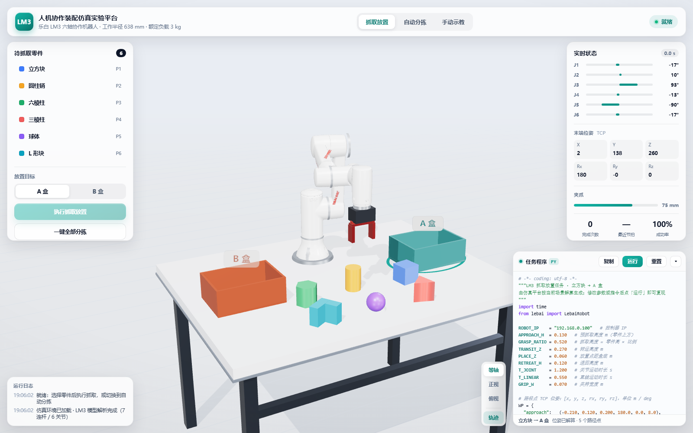

# LM3 人机协作装配仿真实验平台

基于 **乐白 LM3 六轴协作机器人真实 CAD 模型** 搭建的浏览器端机器人仿真实验平台。场景包含一张操作桌面、LM3 协作机器人、6 个不同形状的待抓取零件，以及两个用于分拣的料盒。

- 渲染与交互：Three.js（开源 WebGL 框架）
- 运动学：由 STEP 模型几何反求的 6 轴串联链，自带解析前向运动学与阻尼最小二乘（DLS）逆运动学
- 无需安装服务、无需联网、无需后端，双击 `start.bat` 即可运行

**在线演示**：<https://dreamadmirer.github.io/lm3-assembly-sim/>



---

## 1. 快速开始

**方式一（推荐）**：双击 `start.bat`，脚本会自动在 `8123` 端口启动本地静态服务并打开浏览器。

**方式二**：在本目录执行任意静态服务器，例如：

```bash
python -m http.server 8123
# 然后访问 http://localhost:8123/index.html
```

> 页面使用 ES Module 与 `fetch` 加载 GLB 模型，因此必须通过 **http://** 访问；直接双击 `index.html`（file://）会被浏览器拦截。

### 部署到 GitHub Pages

本仓库已按「main 分支根目录」发布，更新方式：

1. 提交并推送到 `main`；
2. 首次部署需在仓库 **Settings → Pages** 中把 Source 设为 `Deploy from a branch`、分支 `main`、目录 `/`；
3. 约 1 分钟后访问 `https://<用户名>.github.io/lm3-assembly-sim/`。

> 仓库内已包含 `.nojekyll`，可避免 Jekyll 处理 `vendor/`、`js/` 等目录。

浏览器要求：Chrome / Edge / Firefox 等支持 WebGL2 的现代浏览器。

---

## 2. 实验场景

| 元素 | 说明 |
| --- | --- |
| 操作桌面 | 1220 × 940 mm 工作台，台面为安装基准面（z = 0），带桌腿与横梁 |
| LM3 机器人 | 来自 `乐白机器人三维模型-LM3.stp`，7 个连杆（ARM0–ARM6）、6 个旋转关节，高约 895 mm；涂装参考官网实机：亮面白机身 + 关节浅灰环带 + 红色 LEBAI 标识 + 红色阳极氧化夹爪 |
| 末端夹爪 | 参考 LMG-90 造型的两指平行夹爪，开口 14–95 mm |
| 待抓零件 | 立方块、圆柱销、六棱柱、三棱柱、球体、L 形块，共 6 件，尺寸 55–90 mm，分两排布置在机器人正前方 |
| 料盒 | A 盒（青）、B 盒（陶土红），260 × 190 × 100 mm，每个盒子 2×2 放置位 |

零件按形状分为两类，自动分拣时 **回转体 → A 盒，多面体 → B 盒**。

---

## 3. 功能

### 抓取放置
1. 在左侧列表或 3D 视图中点选零件（3D 中选中的零件脚下会出现高亮圆环）；
2. 选择目标料盒（A / B，也可直接在 3D 中点击料盒）；
3. 点击「执行抓取放置」，机器人依次完成 *接近 → 下降 → 夹紧 → 提升 → 搬运 → 下放 → 松开 → 退回* 全流程，并记录节拍。

### 路径规划与程序编辑
- 每次抓取前先做**路径规划**：解算 5 个关键路径点（预抓取 / 抓取点 / 转运点 / 放置点 / 退回），在场景中逐个点亮并连成虚线路径，状态栏同步显示「路径规划 n/5」；
- 右下角「任务程序」面板展示**完整的 Python 程序**（约 60 行），按当前场景真实解算：
  - 头部为任务说明与 8 个可调参数（`APPROACH_H`、`GRASP_RATIO`、`TRANSIT_Z`、`PLACE_Z`、`RETREAT_H`、`T_JOINT`、`T_LINEAR`、`GRIP_W`）；
  - `WP` 字典给出 6 个路径点的 TCP 位姿 `[x, y, z, rx, ry, rz]`（m / deg），`Q` 字典给出对应关节角 `[J1..J6]`（deg）；
  - `main()` 中按步骤调用 `robot.movej / movel / gripper_close / gripper_open / home`，每步带行内注释；
- 面板支持 Python 语法高亮（关键字、字符串、数字、函数、注释、常量分色）、Tab 缩进、复制到剪贴板、折叠；
- 代码是**可执行**的：内置解析器读取这份 Python 子集，改参数或调整指令顺序后点「运行」即按新程序重新规划并执行；未识别语句会在页脚报出行号；
- 「轨迹」按钮控制 TCP 运行轨迹显隐，轨迹按运动阶段着色（同一段颜色对应同一个路径点）。

### 自动分拣
点击「一键全部分拣」，机器人按形状类别连续完成 6 个零件的分拣，可随时中止。完成后统计完成次数、最近节拍与成功率。

### 手动示教
- 6 个关节滑块实时拖动，读数与 3D 模型同步；
- 「记录示教点」保存当前关节角，「回放」按记录顺序匀速复现轨迹；
- 「零位 / 工作位」一键回到标准姿态。

### 实时状态
- 关节角（带行程条与超限变色）；
- 末端 TCP 位姿（X/Y/Z 单位 mm，Rx/Ry/Rz 单位 deg）；
- 夹爪开口（mm）；
- 完成次数 / 最近节拍 / 成功率；
- 运行日志与视角切换（等轴 / 正视 / 俯视）。

---

## 4. 目录结构

```
人机协作装配实验平台/
├─ index.html              页面骨架 + importmap
├─ start.bat               一键启动（Windows）
├─ css/style.css           界面样式
├─ js/
│  ├─ config.js            场景布局、零件参数、关节限位、标准姿态
│  ├─ kinematics.js        LM3 运动学（FK / Jacobian / DLS-IK）
│  ├─ planner.js           路径点解算、程序生成与解析（可编辑 DSL）
│  ├─ pathviz.js           路径点标记、规划连线、TCP 轨迹
│  ├─ robot.js             模型加载、夹爪、关节插补与直线运动
│  ├─ scene.js             桌面、料盒、零件、灯光与环境
│  └─ app.js               交互逻辑、任务编排、界面刷新
├─ assets/lm3.glb          由 STEP 转换的 7 连杆网格（约 2.4 MB）
├─ vendor/three/           Three.js r169（本地化，离线可用）
└─ 乐白机器人三维模型-LM3.stp   原始 CAD 模型
```

---

## 5. 技术说明

### 5.1 从 CAD 到可驱动的模型

原始 `.stp` 为 SolidWorks 导出的装配体，包含 `ARM0`–`ARM6` 七个零件。处理流程：

1. 用 OpenCASCADE（`cadquery-ocp`）读取 STEP 装配树，按零件名提取各自的世界坐标网格；
2. 对每个零件遍历圆柱面，按 **半径 + 轴线共线** 匹配相邻连杆的配合面，反求出 6 条关节轴线；
3. 按三角面片导出 GLB（顶点法线由曲面微分计算，保留圆柱面光滑着色）。

求得的关节轴线（模型坐标，mm）：

| 关节 | 轴线上一点 | 轴向 |
| --- | --- | --- |
| J1 底座回转 | (0, 0, 97.5) | (0, 0, 1) |
| J2 肩部 | (-45.96, 45.96, 215.83) | (-0.7071, 0.7071, 0) |
| J3 肘部 | (-99.71, 99.71, 495.83) | (-0.7071, 0.7071, 0) |
| J4 腕部 1 | (-15.77, 15.77, 755.83) | (-0.7071, 0.7071, 0) |
| J5 腕部 2 | (-85.30, 85.30, 755.83) | (0, 0, 1) |
| J6 腕部 3 / 法兰 | (-85.30, 85.30, 854.16) | (-0.7071, 0.7071, 0) |

法兰面距 J6 轴线原点 83 mm，夹爪两指中心（TCP）距原点 173 mm。

### 5.2 运动学

- **正运动学**：以螺旋运动（指数积）形式串联 6 个关节，`T = exp(S1θ1)…exp(S6θ6)·M`，M 为零位 TCP 位姿；
- **逆运动学**：几何雅可比 + 阻尼最小二乘迭代（`dq = Jᵀ(JJᵀ + λ²I)⁻¹e`），位置权重 1、姿态权重 0.35，单次求解 ≤ 120 次迭代；
- 由于 LM3 腕部存在 98 mm 偏置（J6 与 J5 不相交），逆解不适合闭式求解，采用 **多初值 + 姿态代价择优**：以当前关节角与 9 组典型工作姿态为种子，优先选择与当前构型最接近的可行解，保证运动连续、无腕部翻转。

### 5.3 任务编排

抓取流程以笛卡尔直线（下降/提升）与关节空间插补（转场）组合实现：

```
工作位 → (关节) 预抓取位 → (直线) 抓取位 → 夹紧 → (直线) 提升
      → (关节) 料盒上方 → (直线) 放置位 → 松开 → 落料 → 退回 → 工作位
```

若某个位姿不可达，会按「末端偏航 ±0.5/±1.0 rad、高度 +0/−40/+100 mm」依次回退求解；仍失败则回收已夹持零件并给出提示，不会卡死。

---

## 6. 可扩展方向

- 在 `js/config.js` 中增删零件、调整料盒位置（`OBJECTS` / `BINS`）；
- 替换 `assets/lm3.glb` 即可换用其他机器人模型（需同步修改 `kinematics.js` 中的关节轴线）；
- 接入真实机器人时，可将 `robot.js` 的运动指令替换为乐白 SDK（Python / C# / JS 均有官方支持）的关节/笛卡尔指令。

---

## 7. 依赖与许可

- [Three.js](https://threejs.org/) r169 — MIT License（已本地化至 `vendor/three/`）
- OpenCASCADE / `cadquery-ocp` — 仅用于离线模型转换，运行时不需要
- 乐白 LM3 三维模型版权归原厂所有，仅用于教学与实验演示
